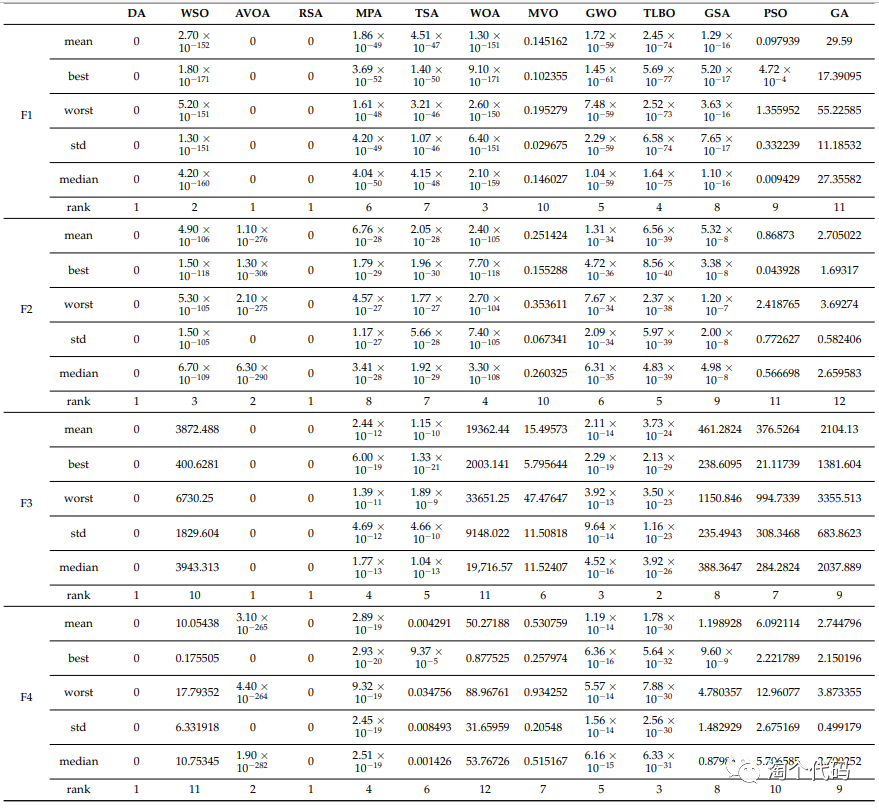
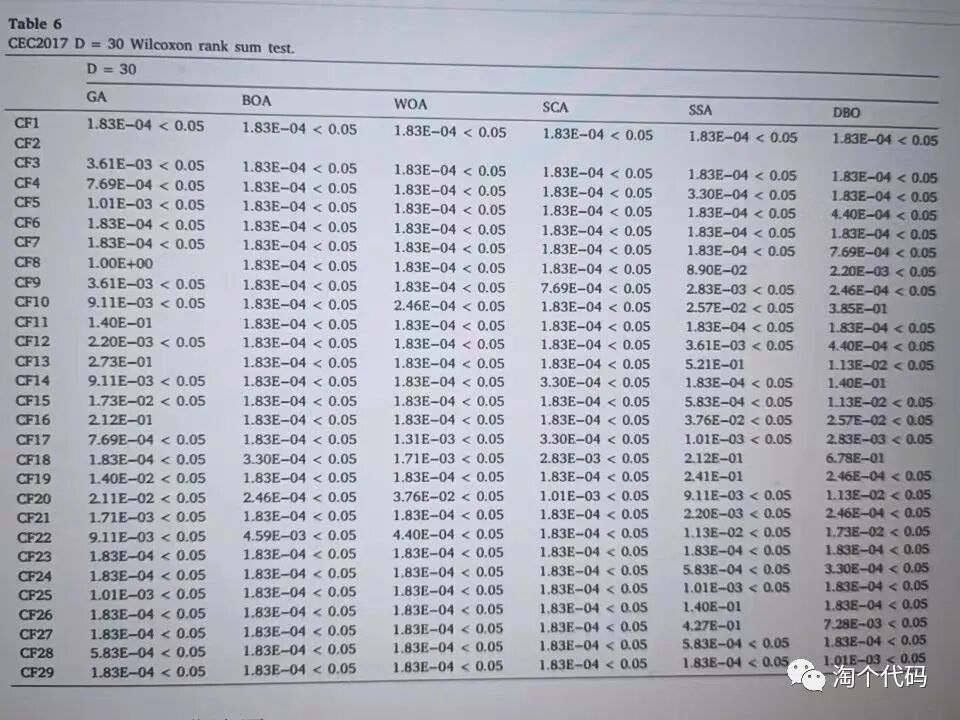
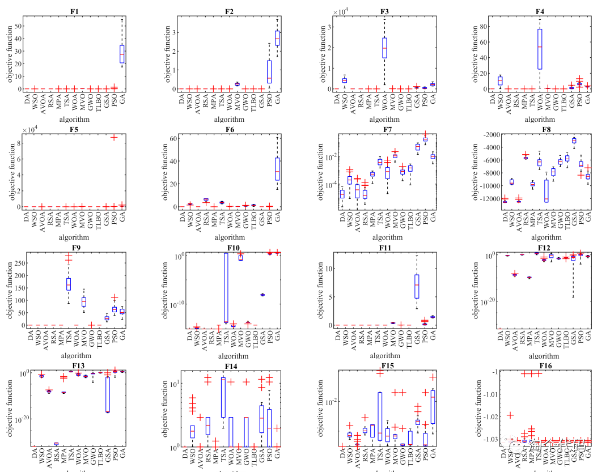
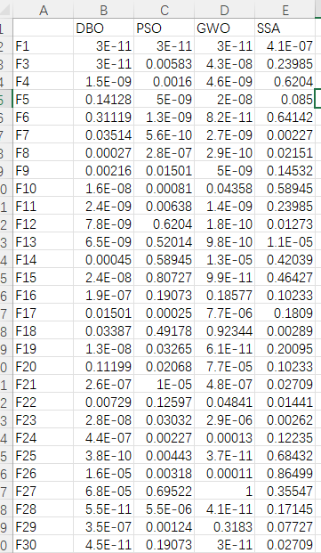
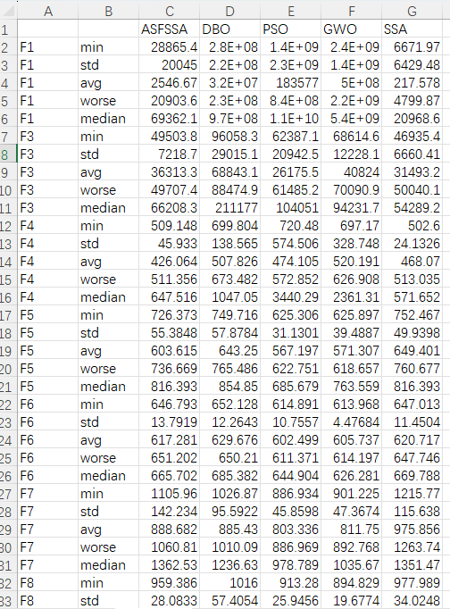
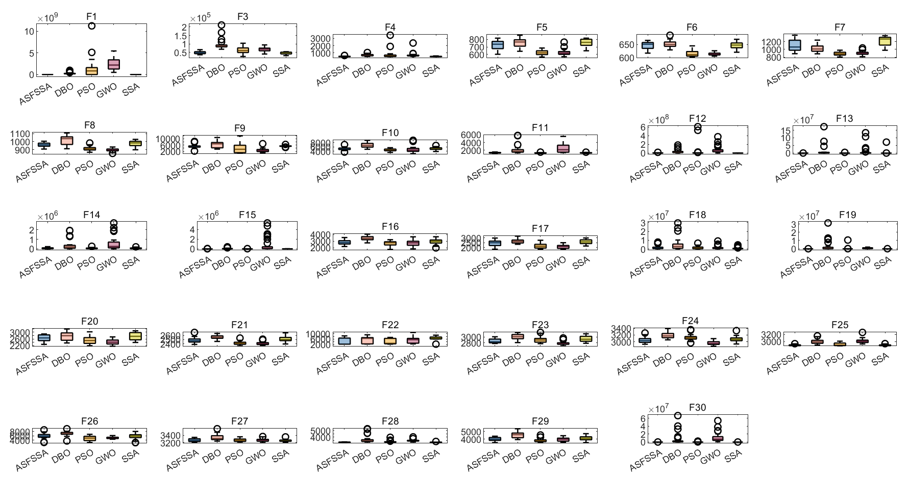

# CEC2017 function set optimal value, average, standard deviation, worst value, median, rank sum test, box plot, commonly used indicators for intelligent optimization algorithms to be exported as Excel

Previously, we published an article on the intelligent algorithm indicators for the CEC2005 function set. However, many backers have inquired about how to call other function sets. Today, we will use the CEC2017 function set as an example to demonstrate.

To highlight the effectiveness of improving intelligent optimization algorithms, it is common to compare these improved algorithms with others.

In some journal papers, one often sees a very large table that summarizes various metrics such as the mean, standard deviation, optimal value, worst value, and median for each algorithm. For example:

Some papers also use rank sum tests to compare the differences between improved algorithms and their counterparts. For instance:

Other papers might use box plots to present more intuitive results. For example:

However, if you had to manually run code over and over again to perform these calculations, even superheroes would find this impractical!

Today, we will use MATLAB tools to teach everyone how to perform these tasks directly, export Excel tables, and draw box plots.

Algorithm replacement is very simple; just replace the algorithm name! Test set replacement is also straightforward!

For this session, we will use the Adaptive Spherical Search Algorithm (ASFSSA) (click here to access the algorithm for free) as an example, comparing it with the Beetle Optimization Algorithm, Sparrow Optimization Algorithm, Particle Swarm Optimization Algorithm, and Grey Wolf Optimization Algorithm.

We will run each algorithm 30 times in the CEC2017 function and test them using the CEC2017 function. We will automatically calculate the optimal value, mean, standard deviation, median, worst value, and rank sum result, along with drawing box plots.

The code directory is as follows:

Among them, plotCEC2017_Main.m is the usual program for drawing algorithm comparison charts, which has always been available.

The key point is: runsCEC2017_Main.m, which runs after execution can generate two Excel files: ranksumresult.xls and result.xls.

ranksumresult.xls contains the statistical results of the rank sum test, while result.xls contains the statistics for five indicators. The results are as follows:
ranksumresult.xls table:
\n        \n      result.xls table:
\n        \n      The program has coded the option to draw box plots, which can also be changed with a single click. The box plot is as follows:
\nPart of the code is shown.
The code for part of the "runsCEC2017_Main.m" file is as follows:
clear\nclc\nclose all\naddpath(genpath(pwd));\npop_size=30;   %Population number\nmax_iter=500;   % Iteration count\n​\nrun = 30;\nbox_pp = 1;  % Optional: 1, or other. When equal to 1, draw a box plot; otherwise, do not draw.\nRESULT=[];   % Calculate the standard deviation, mean, optimal value, etc.\nrank_sum_RESULT=[];  % Calculate the rank sum test results\n​\nF = [1 3 4 5 6 7 8 9 10 11 12 13 14 15 16 17 18 19 20 21 22 23 24 25 26 27 28 29 30];% Because the second function has been deleted!\nvariables_no = 30; % Optional: 2, 10, 30, 50, 100\ndisp(['The one being counted is',num2str(variables_no),'Output the English term only:CEC2017Function set'])\nif box_pp ==1\n    figure('Name', 'Box plot', 'Color', 'w','Position', [50 50 1400 700])\nend\n​\nfor func_num = 1:length(F)    \n    % Display the comprehensive results\n    disp(['F',num2str(F(func_num)),'Function calculation results: '])\n    [lower_bound,upper_bound,variables_no,fhd]=Get_Functions_details(['F',num2str(F(func_num))]);\n    resu = [];  % Calculate the results such as standard deviation, mean, optimal value, etc.\n    rank_sum_resu = [];   % Calculate the rank sum test results\n    box_plot = [];  % Statistical box plot results\n    ……\nend\n%% Write the rank sum test result into elcex\nB = string();\nfor i = 1:length(F)\n    str = string(['F',num2str(F(i))]);\n    B(i,1)= str;\nend\nB = cellstr (B);\nB = [B,num2cell(rank_sum_RESULT)];\ntitle = {" ","DBO","PSO","GWO","SSA"};% The rank sum test is compared with an improved algorithm, so there is no improved algorithm here.\nB = [title;B];\nxlswrite('ranksumresult.xls', B)\n​\n%% Write the results of standard deviation, mean, optimal value, etc. into elcex.\nA = string();\nA = cellstr (A);\nA = [A,num2cell(RESULT)];\ntitle = {" "," ","ASFSSA","DBO","PSO","GWO","SSA"};\nA = [title;A];\nxlswrite('result.xls', A)\n\n  

## Images

<!-- PAYMENT_BLOCK -->

## Get this dataset

- Payment link (Stripe): [Buy now](https://buy.stripe.com/3cs8yP7sY87d0vu9AB)
- Payment QR code: 

<!-- /PAYMENT_BLOCK -->
